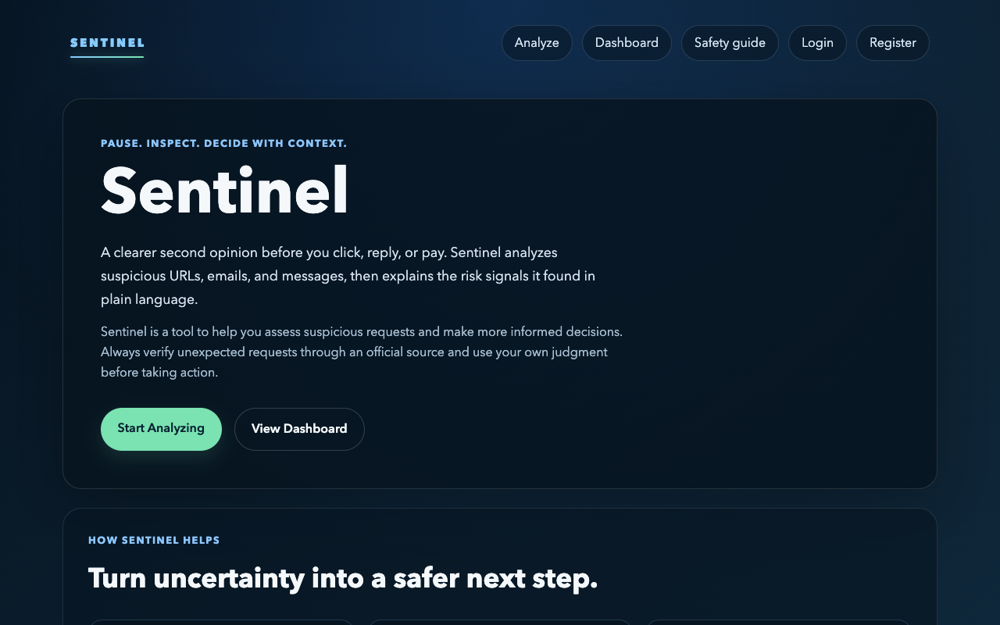
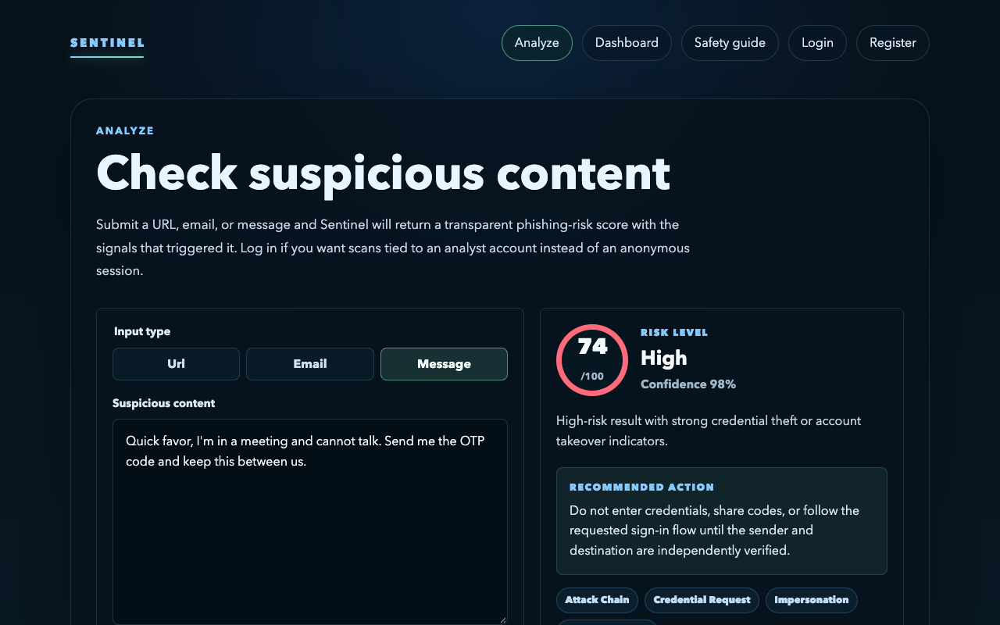
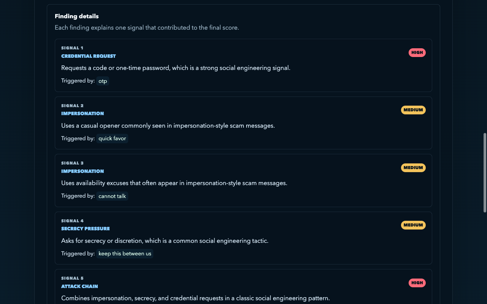
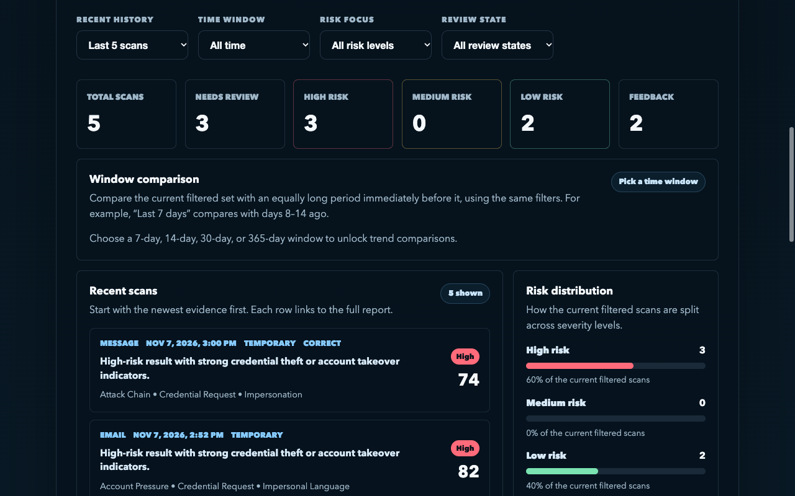
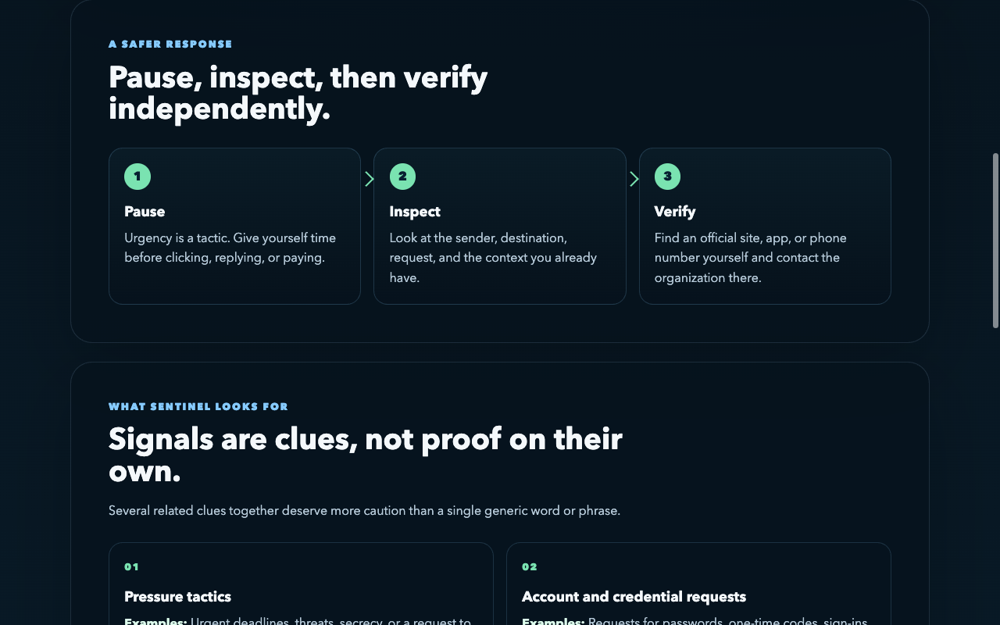

# Sentinel

### Phishing & Social Engineering Threat Analysis

Sentinel is a full-stack cybersecurity application designed to help users identify potentially malicious URLs, emails, and messages through explainable threat analysis.

The application combines rule-based phishing detection, secure user authentication, persistent scan history, and an interactive dashboard to provide a comprehensive environment for evaluating suspicious content.

Rather than returning a risk label without explanation, Sentinel identifies suspicious patterns, provides a heuristic risk score, and explains the indicators behind its findings. The goal is to help users better understand potential threats and make informed decisions before interacting with suspicious content.

## Features

### Phishing and social engineering analysis

Sentinel supports three types of analysis:

- URL analysis examines structural characteristics and suspicious URL patterns.
- Email analysis identifies signs of impersonation, credential requests, urgency, and account pressure.
- Message analysis evaluates social engineering tactics such as payment requests, secrecy, pressure, and attempts to obtain sensitive information.

Each analysis returns a heuristic risk score, a Low/Medium/High classification, contributing indicators, explanations, and recommendations for independent verification. Scores and confidence values are heuristics, not calibrated probabilities or guarantees that content is safe or malicious.

### Accounts, reports, and dashboard

- Registration, login, logout, and revocable account sessions
- Anonymous scanning with session ownership protections
- Account-specific scan history and detailed reports
- Filters for time range, risk level, and review status
- Dashboard summaries, risk distributions, and common indicators
- Feedback and notes attached to reports
- Individual report deletion

Feedback records a user's review. It does not automatically retrain a model or change detection scores.

### Data retention controls

Temporary reports support 7, 14, or 30 days of retention. Registered users can explicitly save reports for longer-term storage and delete them later.

Expired reports become inaccessible through normal requests. Physical deletion depends on the configured cleanup process and backup retention policy. Anonymous credentials expire independently of report retention, so closing a browser is not a deletion guarantee.

### Safety guide

The built-in safety guide covers phishing and social engineering warning signs, independent verification, and safer responses to unexpected requests.

## Screenshots

Synthetic demonstration content. Select an image to view it at full size.

<table>
  <tr>
    <td align="center" width="50%">
      <a href="docs/screenshots/01-landing-page.png"></a><br>
      <sub>Landing page and product overview</sub>
    </td>
    <td align="center" width="50%">
      <a href="docs/screenshots/02-analyze-high-risk.png"></a><br>
      <sub>Message analysis and risk assessment</sub>
    </td>
  </tr>
  <tr>
    <td align="center" width="50%">
      <a href="docs/screenshots/03-scan-report.png"></a><br>
      <sub>Report evidence and detailed findings</sub>
    </td>
    <td align="center" width="50%">
      <a href="docs/screenshots/04-dashboard.png"></a><br>
      <sub>Scan history and dashboard summaries</sub>
    </td>
  </tr>
  <tr>
    <td align="center" colspan="2">
      <a href="docs/screenshots/05-safety-guide.png"></a><br>
      <sub>Safety guidance and verification habits</sub>
    </td>
  </tr>
</table>

## Technology stack

| Component | Technology |
| --- | --- |
| Frontend | Next.js, React, TypeScript, CSS Modules |
| Backend | Python, FastAPI, Pydantic |
| Detection | Explainable heuristic rules |
| Persistence | SQLAlchemy, SQLite, PostgreSQL |
| Authentication | PyJWT, bcrypt, HttpOnly cookies, revocable sessions |
| Migrations | Alembic |
| Shared production security state | Redis |
| Validation | pytest, frontend tests, browser validation, GitHub Actions |

## Architecture

1. The Next.js interface accepts suspicious content and displays reports.
2. FastAPI validates requests and enforces authentication, ownership, CSRF protections, and resource limits.
3. The rule engine examines the submitted text or URL and returns explainable findings.
4. SQLAlchemy persists account data, scan results, findings, and feedback. Authorized requests retrieve history and dashboard summaries.

Submitted URLs are treated as strings. Sentinel does not visit submitted links, execute attachments, or perform live reputation lookups.

See the V1 [architecture](https://github.com/DarienRam/Sentinel/blob/main/docs/architecture.md) and [API contract](https://github.com/DarienRam/Sentinel/blob/main/docs/api-contract.md).

## Getting started

Use Python 3.13.18, Node.js 22.23.4, and npm. Runtime versions are recorded in `.python-version` and `.nvmrc`.

```bash
git clone https://github.com/DarienRam/Sentinel.git
cd Sentinel
bash scripts/setup.sh
bash scripts/dev.sh
```

Open [http://localhost:3000](http://localhost:3000). The backend API is available at [http://127.0.0.1:8000](http://127.0.0.1:8000). Browser API calls follow the browser hostname. Use matching hostnames for frontend/API cookies, and press Ctrl+C to stop both services.

A fresh V1 installation uses an ignored SQLite database and does not require PostgreSQL. Existing configured checkouts continue to use their own database connection. Preserve existing environment files and database records rather than replacing them to follow a fresh-install example.

Setup installs hash-locked Python requirements and locked frontend dependencies. Sanitized [backend](backend/.env.example) and [frontend](frontend/.env.local.example) configuration examples are provided. Never commit real environment files or credentials.

The combined runner is for local development. Hosted operation requires production configuration, fresh secrets, exact HTTPS origins, secure cookies, protected Redis state, reviewed database migrations, TLS, and operational validation.

## Testing

The automated tests cover detection behavior, account and anonymous-session isolation, authentication, request validation, persistence, and security controls.

From `backend/`:

```bash
.venv/bin/python -m pytest app/tests -q -p no:cacheprovider
.venv/bin/python -m ruff check app migrations --select E9,F63,F7,F82
.venv/bin/python -m pip check
.venv/bin/python -m pip_audit -r requirements.lock --no-deps --disable-pip
```

From `frontend/`:

```bash
npm test
npm run lint
npm run typecheck
npm run build
npm audit --audit-level=moderate
```

Tests use synthetic data and disposable databases. GitHub Actions runs the V1 backend, frontend, and dependency checks. Browser journeys complement the automated suites. Passing these checks does not establish detection accuracy or production readiness.

## Security and privacy

Account sessions use HttpOnly cookies, server-side revocation, and Origin/CSRF checks for browser mutations. Passwords are hashed with bcrypt. Anonymous sessions are isolated from account-owned reports. Memory-backed development sessions end when the service restarts, without deleting account records.

Submitted content, findings, and feedback may be stored. Avoid submitting real passwords or sensitive personal information. Independently verify unexpected requests through a trusted channel, even when a report has a low risk score.

See the [security policy](https://github.com/DarienRam/Sentinel/blob/main/SECURITY.md) for reporting guidance and operational considerations.

## Future Development

The following are future or experimental directions beyond V1, not current capabilities or validated performance claims:

- Machine-learning-assisted phishing and social engineering detection
- Hybrid analysis combining explainable heuristic rules with machine-learning predictions
- Contextual assessment of suspicious emails, messages, and embedded URLs
- Evaluation against previously unseen and evolving phishing techniques
- Better false-positive handling and broader detection-quality evaluation
- Usability, accessibility, reporting, and account-management improvements

## Data and third-party acknowledgments

The landing-page chart cites the [FTC Consumer Sentinel Network Data Book 2024](https://www.ftc.gov/reports/consumer-sentinel-network-data-book-2024). Its annual totals cover consumer reports across fraud, identity theft, and other consumer-protection concerns, not every scam attempt.

Third-party packages retain their respective licenses. See the [third-party acknowledgments](https://github.com/DarienRam/Sentinel/blob/main/docs/attribution.md).
